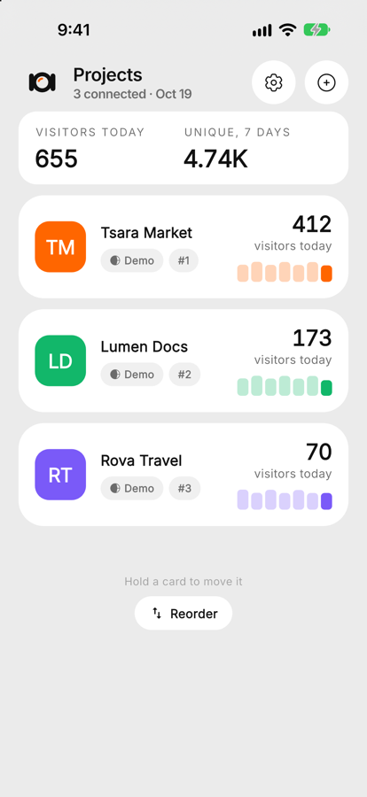
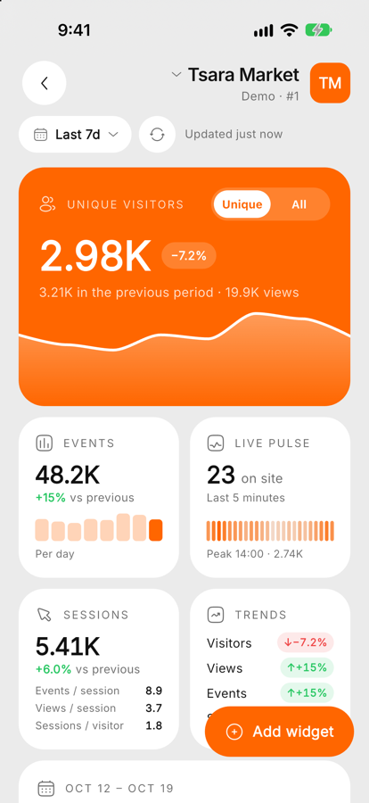
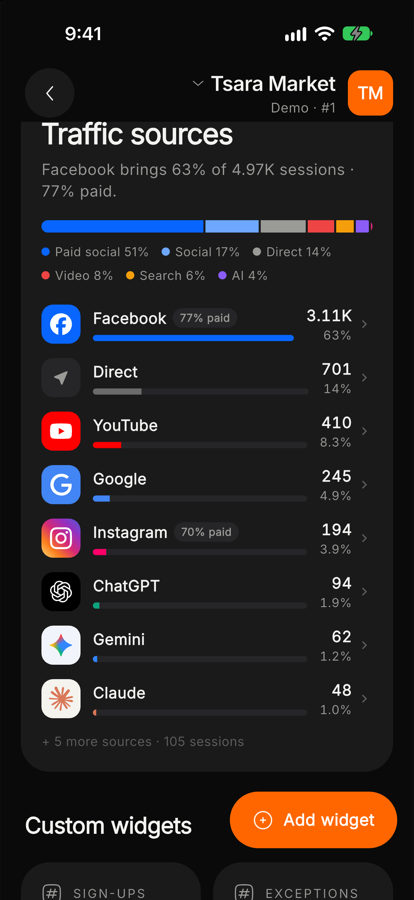
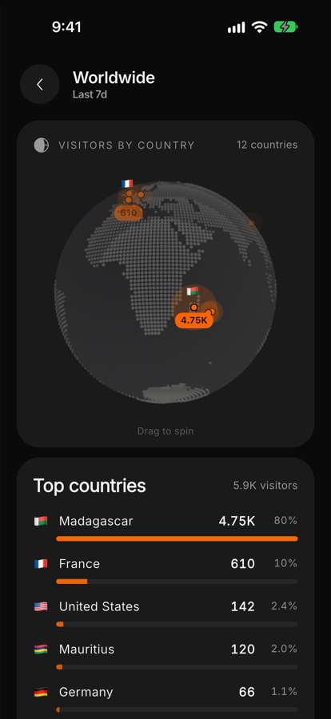

# HogLens

**All your PostHog projects. One lens.**

HogLens is an Android app for PostHog. Add your projects with a personal API key, a name and a logo, and see unique visitors, traffic sources, live events, errors, retention and a 3D globe of where your visitors are, with custom widgets for anything else you track. Data is cached so it still opens offline.

This repository only hosts the releases. Use its [Issues](../../issues) to report a problem or ask for a feature.

## Download

Pick the APK for your phone. If you're not sure, take **arm64**, which fits almost every phone from the last few years.

| Phone | Download |
| --- | --- |
| Most phones (64-bit) | [hoglens-arm64.apk](https://github.com/Diary-Axel-RAKOTOARIVAO/hoglens-releases/releases/latest/download/hoglens-arm64.apk) |
| Older phones (32-bit) | [hoglens-armv7.apk](https://github.com/Diary-Axel-RAKOTOARIVAO/hoglens-releases/releases/latest/download/hoglens-armv7.apk) |
| Emulators and x86 devices | [hoglens-x86_64.apk](https://github.com/Diary-Axel-RAKOTOARIVAO/hoglens-releases/releases/latest/download/hoglens-x86_64.apk) |

These links always serve the newest version. Every release lists what changed and the SHA-256 of each file on the [Releases](../../releases) page. The app also tells you, in Settings, when a new version is out.

## Screenshots

  
  
  
  

## Your data

HogLens talks only to your own PostHog instance. Your personal API keys stay in the phone's secure storage and are never sent anywhere else.
